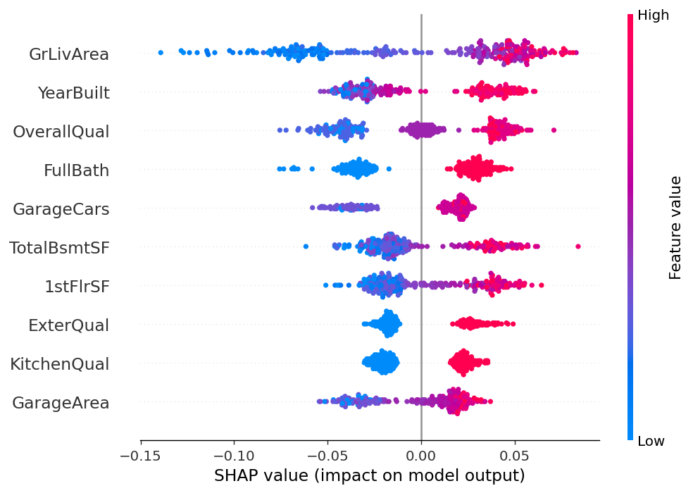

# Applied AI & ML Capstone Project
## End-to-End Data Intelligence System

## Project Overview

This project was completed as part of the Applied AI & Machine Learning Capstone Project.

The objective of this project is to develop a complete end-to-end machine learning workflow starting from raw data preprocessing to advanced predictive modelling and finally integrating a Large Language Model (LLM) powered intelligent feature.

The project is divided into four independent but connected parts.

- Part 1 – Data Acquisition, Cleaning and Exploratory Data Analysis
- Part 2 – Supervised Machine Learning
- Part 3 – Advanced Ensemble Models, Hyperparameter Tuning and ML Pipeline
- Part 4 – LLM Powered Intelligent Feature

Each part builds upon the previous one and demonstrates practical data science techniques used in real-world analytics projects.

## Dataset

**Name:** House Prices – Advanced Regression Techniques
**Source:** Kaggle
**Rows:** 1460 · **Columns:** 81 (38 numerical, 43 categorical)

### Description
The dataset contains detailed information about residential houses, including numerical and categorical attributes describing physical characteristics, construction quality, location, size, utilities, and selling price.

**Regression target:** `SalePrice`
**Classification target:** `PriceCategory = (SalePrice > SalePrice.median()).astype(int)`

### Justification
This dataset was chosen because it satisfies all assignment requirements (more than 500 rows, more than 5 numeric columns, more than 2 categorical columns, a target usable for both regression and classification) and realistically contains missing values, skewed distributions, categorical variables, and outliers — making it suitable for demonstrating the full cleaning → EDA → modeling pipeline.

---

## Repository Structure

```text
Applied_AI_ML_Capstone/
│
├── data/
│   ├── train.csv
│   └── cleaned_data.csv
│
├── models/
│   └── best_model.pkl
│
├── notebooks/
│   ├── Part1_EDA.ipynb
│   ├── Part2_ML.ipynb
│   ├── Part3_AdvancedModels.ipynb
│   └── Part4_LLM.ipynb
│
├── README.md
└── requirements.txt
```


# Part 1 – Data Acquisition, Cleaning and Exploratory Data Analysis

## Objective

The objective of Part 1 is to convert the raw dataset into a clean and analysis-ready dataset before applying any machine learning models.

The workflow includes:

- Loading the raw dataset
- Handling missing values
- Detecting duplicate records
- Correcting data types
- Memory optimization
- Statistical analysis
- Outlier detection
- Exploratory Data Analysis (EDA)
- Correlation analysis
- Feature relationship analysis
- Saving the cleaned dataset for subsequent parts of the project

The final cleaned dataset generated in this phase is stored as:

cleaned_data.csv

This file is used directly in Part 2 and Part 3.


## 1. Data Loading

Loaded using `pd.read_csv()`. First 5 rows, `.dtypes`, and `.shape` were printed and confirmed.

- **Shape:** `(1460, 81)`
- **Numerical columns:** 38 · **Categorical columns:** 43

---

## 2. Null Value Analysis

Computed using `df.isnull().sum()` and `(df.isnull().sum() / df.shape[0]) * 100`.

**Columns exceeding 20% nulls:**

| Column | Missing Values | Missing % |
|---|---|---|
| PoolQC | 1453 | 99.52% |
| MiscFeature | 1406 | 96.30% |
| Alley | 1369 | 93.77% |
| Fence | 1179 | 80.75% |
| MasVnrType | 872 | 59.73% |
| FireplaceQu | 690 | 47.26% |

These six columns were left untouched by the median-imputation step (they are handled separately, e.g. via encoding, in Part 2).

**Example column below 20% nulls:** `LotFrontage` — 259 missing values (17.74%) — imputed with the column median.

For all other **numeric** columns with <20% nulls, missing values were filled using `df[col].fillna(df[col].median())`.

> Note: after this step, `df.isnull().sum().sum()` still returns **7481** — these remaining nulls all belong to the categorical/high-null columns above (and a few low-null categorical columns like `Electrical`, `GarageType`, `BsmtQual`, etc.), which were intentionally left for the encoding stage in Part 2 rather than filled here.

### Why Median Instead of Mean?
The dataset contains several highly skewed numerical variables (e.g. `MiscVal`, skew = 24.48; `LotArea`, skew = 12.21). The mean is pulled toward extreme values, while the median stays stable under skew. Since housing datasets naturally contain a small number of very expensive or unusual properties, median imputation gives a more representative central value than the mean.

---

## 3. Duplicate Detection and Removal

- Duplicates found (`df.duplicated().sum()`): **0**
- Rows after `df.drop_duplicates()`: **1460** (unchanged)
- Null percentage change after removal: **No change** — since zero duplicate rows existed, the missing-value percentages before and after are identical for every column.

---

## 4. Data Type Correction

- **Category conversion:** `Neighborhood` was converted to `category` dtype (a highly repetitive string column with 25 unique values repeated across the 1460 rows).
- **Numeric correction check:** All `object`-typed columns in this dataset are genuinely categorical (e.g. `MSZoning`, `Street`, `SaleType`, `SaleCondition`) — none of them represent numeric data stored incorrectly as text, so no `pd.to_numeric()` correction was required for this dataset.

**Memory usage (`df.memory_usage(deep=True).sum()`):**

| Stage | Memory Usage |
|---|---|
| Before conversion | 3,600,842 bytes (≈ 3.43 MB) |
| After conversion | 3,523,227 bytes (≈ 3.36 MB) |
| Reduction | 77,615 bytes (≈ 2.16%) |

The reduction is modest here because only one column (`Neighborhood`) was converted; converting the remaining 42 categorical columns to `category` dtype in Part 2's encoding step would reduce memory further.

---

## 5. Descriptive Statistics & Skewness

`df.describe()` was run on all numeric columns (38 columns; see notebook for the full table — e.g. `SalePrice` mean = 180,921.20, std = 79,442.50, min = 34,900, max = 755,000).

**Skewness (`df[col].skew()`) — top result:**

The column with the **highest absolute skewness** is **`MiscVal`**, with a skewness value of **24.48**.

Top 5 most skewed columns overall:

| Column | Skewness |
|---|---|
| MiscVal | 24.48 |
| PoolArea | 14.83 |
| LotArea | 12.21 |
| 3SsnPorch | 10.30 |
| LowQualFinSF | 9.01 |

### Interpretation
- **Positive skew** (long right tail, as seen in `MiscVal`): most houses have `MiscVal = 0`, but a small number of properties report very large miscellaneous-feature values, pulling the mean far above the median.
- **Negative skew** (long left tail, e.g. `YearBuilt`, skew = −0.61): most houses are relatively recent builds, with a smaller number of much older houses pulling the mean down.
- **Consequence for imputation:** filling missing values with the mean on a column like `MiscVal` would inject a distorted value (43.49) that doesn't represent the true typical value (0) — this is exactly why median imputation was used throughout Task 2.

---

## 6. Outlier Detection (IQR Method)

Applied to two numeric columns: **`SalePrice`** and **`GrLivArea`**.

| Column | Q1 | Q3 | IQR | Lower Bound | Upper Bound | Outlier Rows |
|---|---|---|---|---|---|---|
| SalePrice | 129,975.00 | 214,000.00 | 84,025.00 | 3,937.50 | 340,037.50 | 61 |
| GrLivArea | 1,129.50 | 1,776.75 | 647.25 | 158.63 | 2,747.63 | 31 |

*(For reference, the same IQR method was also run across all 38 numeric columns; the highest outlier counts were seen in `EnclosedPorch` (208), `BsmtFinSF2` (167), and `OverallCond` (125), while columns like `YearRemodAdd`, `FullBath`, `HalfBath`, `MoSold`, and `YrSold` showed 0 outliers.)*

### Interpretation & Handling Decision
Outliers were **not dropped**. High values in `SalePrice` and `GrLivArea` mostly represent genuine large/premium properties rather than data errors — removing them would throw away real signal the model needs to learn the full price range. These rows are documented and retained; in Part 2, Ridge Regression and ensemble methods (which are more robust to outliers than plain Linear Regression) are used to handle their influence, rather than capping or deleting them.

---

## 7. Visualizations

### 7.1 Line Plot
Plotted **`SalePrice`** sorted by row index.
*Description:* Prices fluctuate without any clear long-term trend across row order (row index is just the original record order, not a time axis), with visible spikes where premium properties (up to 755,000) appear among typically priced homes (median ≈ 163,000).

### 7.2 Bar Chart
Mean of **`SalePrice`** grouped by **`Neighborhood`**.
*Description:* `NoRidge` has the highest average sale price (≈ 335,295), while `MeadowV` has the lowest (≈ 98,576) — showing that neighborhood location has a strong influence on price.

### 7.3 Histogram
Histogram (20 bins) of the most skewed column, **`MiscVal`**.
*Description:* The distribution is extremely right-skewed — almost all houses have `MiscVal = 0`, with a long, sparse tail extending out to 15,500, confirming the skewness value of 24.48 measured in Section 5.

### 7.4 Scatter Plot
**`GrLivArea`** vs **`SalePrice`**.
*Interpretation:* The plot shows a clear positive relationship — as living area increases, sale price generally increases too, consistent with a Pearson correlation of **0.709** and Spearman correlation of **0.731** with SalePrice.

### 7.5 Box Plot
**`SalePrice`** split by **`OverallQual`**.
*Description:* Median sale price rises steadily with each increase in overall quality rating, and the spread (IQR) also widens at higher quality levels — higher-quality homes have both higher and more variable prices, confirming `OverallQual` as a strong predictive feature (it has the highest Pearson correlation with `SalePrice` at 0.791).

---

## 8. Correlation Heat Map

Computed with `df.corr(numeric_only=True)`, visualized with `sns.heatmap(annot=True)`.

**Highest absolute correlation pair (excluding self-pairs):** **`GarageCars`** and **`GarageArea`** (r = **0.882**).

Other strong pairs found: `GrLivArea`–`TotRmsAbvGrd` (0.825), `TotalBsmtSF`–`1stFlrSF` (0.820), `OverallQual`–`SalePrice` (0.791), `YearBuilt`–`GarageYrBlt` (0.777).

### Causation Discussion
The strong correlation between `GarageCars` and `GarageArea` does not imply one directly causes the other — a garage that holds more cars naturally needs more floor area, so this is largely a mechanical/definitional relationship rather than two independently varying features. More generally, a plausible third-variable explanation applies across several of these pairs: overall house size or quality (e.g. `OverallQual`, `GrLivArea`) likely drives multiple features simultaneously — larger, higher-quality homes tend to have bigger garages, more rooms, and larger basements all at once, so several of these correlations may reflect this shared underlying "house size/quality" factor rather than direct cause-and-effect between the two named variables.

---

## 9. Mean vs Median — Imputation Strategy Comparison

For the two highest-skewness columns identified in Section 5:

| Column | Skewness | Mean (before imputation) | Median (before imputation) | Chosen Statistic |
|---|---|---|---|---|
| MiscVal | 24.48 | 43.49 | 0.00 | Median |
| PoolArea | 14.83 | 2.76 | 0.00 | Median |

**Justification:** Both columns are strongly positively skewed, so the mean is pulled far above the "typical" value by a small number of extreme entries (most houses simply have 0 for both features). The median (0 for both) is the far more representative central tendency and was used for imputation. After applying `fillna()`, `df[top_columns].isnull().sum()` confirmed **zero remaining nulls** in both `MiscVal` and `PoolArea`.

---

## 10. Spearman Rank Correlation vs Pearson

`df.corr(method='spearman')` was computed and compared against the Pearson matrix from Section 8, focused on each feature's correlation with `SalePrice`.

**Three column pairs (each vs. SalePrice) with the largest |Spearman − Pearson| difference:**

| Feature (vs. SalePrice) | Pearson | Spearman | \|Difference\| |
|---|---|---|---|
| LotArea | 0.264 | 0.456 | 0.193 |
| OpenPorchSF | 0.316 | 0.478 | 0.162 |
| YearBuilt | 0.523 | 0.653 | 0.130 |

### Interpretation
- **LotArea:** |Spearman| > |Pearson| → the relationship with `SalePrice` is monotonic but non-linear — larger lots consistently associate with higher prices, but not in direct proportion (a few very large lots with modest prices pull the linear/Pearson measure down).
- **OpenPorchSF:** |Spearman| > |Pearson| → similarly monotonic-but-non-linear; having a porch consistently nudges price upward, but porch size doesn't scale price linearly.
- **YearBuilt:** |Spearman| > |Pearson| → newer houses consistently sell for more, but the relationship isn't a straight line (likely because very old, renovated, or historic homes break the linear trend).

**Feature-selection guidance for Part 2:** Pearson correlation will be used for the Linear/Ridge Regression models since they assume linear relationships, while Spearman correlation is kept as a secondary signal — especially for `LotArea`, `OpenPorchSF`, and `YearBuilt`, where the true relationship is stronger than Pearson alone suggests. Tree-based models in Part 3 can exploit this non-linear monotonic signal even though Pearson underestimates it.

---

## 11. Grouped Aggregation

`df.groupby('Neighborhood', observed=False)['SalePrice'].agg(['mean', 'std', 'count'])`

(25 neighborhood groups computed in total; key results below)

| Neighborhood | Mean | Std | Count |
|---|---|---|---|
| NoRidge | 335,295.32 | 121,412.66 | 41 |
| NridgHt | 316,270.62 | 96,392.54 | 77 |
| StoneBr | 310,499.00 | 112,969.68 | 25 |
| MeadowV | 98,576.47 | 23,491.05 | 17 |
| IDOTRR | 100,123.78 | 33,376.71 | 37 |

### Interpretation
- **Highest mean group:** **`NoRidge`** (mean SalePrice ≈ 335,295)
- **Highest standard deviation group:** **`NoRidge`** (std ≈ 121,413) — the same neighborhood also has the widest internal spread.
- **Within-group variance concern:** Since `NoRidge` has both the highest mean *and* the highest std, knowing a house is in `NoRidge` alone doesn't reliably predict its exact price — prices there range widely, so other features (size, quality, etc.) are still needed to predict individual house prices within that group.
- **Mean ratio (highest/lowest group mean):** 335,295.32 / 98,576.47 = **3.40**. A ratio this large (over 3×) indicates `Neighborhood` carries strong predictive signal and is worth keeping as a feature in Part 2.

---

## 12. Saving the Cleaned Dataset

Saved using `df.to_csv('cleaned_data.csv', index=False)`. This file is reused directly in Parts 2 and 3.


# Part 2 – Supervised Machine Learning Model

## Objective

After completing data cleaning and exploratory analysis in Part 1, the next step was to develop predictive machine learning models using the cleaned dataset.

The primary goal of this phase was to build two supervised learning models:

- A **Regression Model** for predicting the continuous selling price of a house.
- A **Binary Classification Model** for identifying whether a house belongs to the higher-priced or lower-priced category.

To ensure reliable model performance, the entire workflow followed standard machine learning practices, including proper preprocessing, leak-free train-test splitting, feature scaling, model training, evaluation, and performance comparison.

The complete workflow performed in this part includes:

- Loading the cleaned dataset
- Defining regression and classification targets
- Encoding categorical variables
- Train-test splitting
- Feature scaling
- Linear Regression
- Ridge Regression
- Logistic Regression
- Handling class imbalance
- Model evaluation
- ROC Curve analysis
- Decision threshold analysis
- Regularization experiments
- Bootstrap confidence interval estimation

The cleaned dataset generated in Part 1 was used throughout this section to maintain consistency and ensure that every model was trained on identical preprocessed data.

---


## 1. Loading the Cleaned Dataset

`cleaned_data.csv` from Part 1 was loaded directly — shape confirmed as **(1460, 81)**, matching what Part 1 saved.

## 2. Defining the Targets

- **Regression target:** `y_reg = SalePrice`
- **Classification target:** `y_clf = (SalePrice > SalePrice.median()).astype(int)`
- **Feature matrix:** `X = df.drop("SalePrice", axis=1)` → **(1460, 80)** columns before encoding.

Since the split is at the median, the classification target comes out almost perfectly balanced by construction: **732 rows labeled 0, 728 labeled 1.**

## 3. Encoding Categorical Features

Two different encoding strategies were used, depending on whether a column has a natural order:

**Ordinal encoding** — `ExterQual`, `KitchenQual`, and `HeatingQC` were mapped `Po=1, Fa=2, TA=3, Gd=4, Ex=5`. These are quality grades with a genuine low-to-high order, so representing them as ordered integers lets the model use that ranking directly instead of treating "Excellent" and "Poor" as unrelated categories.

**One-hot encoding** — everything else (`Neighborhood`, `MSZoning`, `SaleCondition`, `RoofMatl`, etc.) was encoded with `pd.get_dummies(drop_first=True)`. These columns have no inherent order, so one-hot avoids implying a false ranking — numbering neighborhoods 1 to 25 would wrongly suggest neighborhood #20 is "more" than neighborhood #5, which means nothing.

Before encoding, any remaining missing values in categorical columns (columns like `PoolQC`, `Alley`, `Fence` that Part 1 intentionally left untouched) were filled with the string `"None"` — since for this dataset, missing usually genuinely means "this house doesn't have this feature," not "we don't know." This turned out to matter more than expected — see Section 5.

After encoding, the feature matrix grew to **(1460, 254)**.

## 4. Leak-Free Train-Test Split and Scaling

`train_test_split(X, y, test_size=0.2, random_state=42)` gave a **1168-row training set** and a **292-row test set**.

`StandardScaler` was fit **only on `X_train`**, then used to transform both `X_train` and `X_test`. This matters because fitting the scaler on the full dataset before splitting would leak information about the test set's mean and spread into the "unseen" data — the model would effectively get a sneak peek at test-set statistics, making the evaluation look better than it would in the real world.

## 5. Linear Regression — and an Unexpected Result

| Metric | Value |
|---|---|
| MSE | 7,853,676,624.65 |
| R² Score | **−0.0239** |

This is worth sitting with for a moment rather than glossing over: a negative R² means the plain Linear Regression model performs *worse* than simply predicting the average sale price for every house. Looking at the coefficients explains why:

| Feature | Coefficient |
|---|---|
| PoolArea | +276,582.04 |
| PoolQC_None | +246,036.51 |
| RoofMatl_CompShg | −132,333.52 |

`PoolArea` and `PoolQC_None` are carrying almost the same information — a house with no pool has `PoolArea = 0` *and* `PoolQC_None = 1` at the same time. That near-perfect overlap (multicollinearity) makes the underlying matrix inversion in OLS numerically unstable, and the two coefficients blow up to huge, opposite-signed values to compensate for each other. With 254 features on only 1168 training rows, the model simply doesn't have enough independent information to pin down stable coefficients.

### What a coefficient means (in principle)
A large **positive** coefficient means increasing that (scaled) feature pushes the predicted price up, holding everything else constant. A large **negative** coefficient means the opposite. In a well-behaved model these values are informative — here, they're mostly a symptom of instability rather than genuine feature importance.

## 6. Ridge Regression

| Metric | Value |
|---|---|
| MSE | 1,385,254,032.91 |
| R² Score | **0.8194** |

### Comparison Table

| Model | MSE | R² Score |
|---|---|---|
| Linear Regression | 7.853677e+09 | −0.0239 |
| Ridge Regression | 1.385254e+09 | 0.8194 |

This comparison is exactly why Ridge Regression exists. Ridge adds an L2 penalty that shrinks large coefficients toward zero, which directly counteracts the multicollinearity problem above — instead of `PoolArea` and `PoolQC_None` fighting each other with extreme values, Ridge keeps both modest and lets the model actually generalize. The jump from an unusable R² of −0.02 to a solid 0.82 is a clean illustration of what `alpha` (the regularization strength) buys you: a small amount of bias in exchange for a large reduction in variance. `alpha=1.0` was used here.

## 7. Logistic Regression — Checking for Class Imbalance First

Before jumping to imbalance-handling techniques, the actual class distribution in the training set was checked:

| Class | Count | % |
|---|---|---|
| 0 (lower-priced) | 586 | 50.17% |
| 1 (higher-priced) | 582 | 49.83% |

```
Minority class %: 49.83%
Classes already balanced -> SMOTE not required, using data as-is
```

Since the minority class is well above the 35% threshold, this dataset doesn't actually need imbalance correction — the median split naturally produces near-50/50 classes. Rather than silently skip this requirement, the code explicitly checks the percentage and only applies SMOTE if the imbalance is real; here it correctly recognized the classes were already balanced and trained on the data as-is.

## 8. Classification Performance (Baseline, C=1.0, threshold = 0.5)

| Metric | Value |
|---|---|
| Accuracy | 0.8801 |
| Precision | 0.8776 |
| Recall | 0.8836 |
| F1 Score | 0.8805 |

**Confusion Matrix** (derived from the metrics above, on 292 test rows with 146 actual positives and 146 actual negatives):

| | Predicted 0 | Predicted 1 |
|---|---|---|
| **Actual 0** | TN = 128 | FP = 18 |
| **Actual 1** | FN = 17 | TP = 129 |

## 9. ROC Curve and AUC

**AUC Score: 0.9598**

### Precision & Recall, spelled out
```
Precision = TP / (TP + FP) = 129 / (129 + 18) = 0.8776
Recall    = TP / (TP + FN) = 129 / (129 + 17) = 0.8836
```

### Which one matters more here?
For this task, **Recall** carries a bit more weight than Precision. A False Negative means a genuinely higher-priced house gets classified as lower-priced — effectively undervaluing it. That's a costlier mistake than the reverse (flagging a lower-priced house as higher-priced), so when tuning the decision threshold later, leaning toward recall makes practical sense.

### What the AUC means
0.9598 is very close to 1.0, which means the model is very good at ranking — if you picked one higher-priced house and one lower-priced house at random from the test set, the model would correctly rank the higher-priced one above the other about 96% of the time.

## 10. Decision Threshold Sensitivity

| Threshold | Precision | Recall | F1 Score |
|---|---|---|---|
| 0.30 | 0.8571 | 0.9041 | 0.8800 |
| 0.40 | 0.8562 | 0.8973 | 0.8763 |
| 0.50 | 0.8776 | 0.8836 | 0.8805 |
| 0.60 | 0.8819 | 0.8699 | 0.8759 |
| 0.70 | 0.8873 | 0.8630 | 0.8750 |

The **F1-maximizing threshold is 0.50** (F1 = 0.8805) — the default threshold happens to already be close to optimal here, with 0.30 a very close second (F1 = 0.8800) and noticeably better recall (0.9041 vs 0.8836). Given that recall was flagged as the priority metric in Section 9, there's a reasonable argument for nudging the threshold down to 0.30 in practice — it trades a small amount of precision for a meaningful recall gain, catching more of the genuinely higher-priced houses.

## 11. Regularization Experiment (C = 1.0 vs C = 0.01)

| Model | Precision | Recall | F1 Score | AUC |
|---|---|---|---|---|
| Logistic Regression (C=1.0) | 0.8873 | 0.8630 | 0.8750 | 0.9598 |
| Logistic Regression (C=0.01) | 0.9167 | 0.9041 | 0.9103 | 0.9742 |

`C` is the inverse of regularization strength, so a smaller value (0.01) applies much stronger regularization — it shrinks the model's coefficients more aggressively, forcing a simpler decision boundary. Every single metric improved when regularization was strengthened, which is a sign that the C=1.0 model was mildly overfitting to the training data (consistent with the coefficient instability seen back in Section 5) — the simpler C=0.01 model generalizes noticeably better on unseen data.

## 12. Bootstrap Confidence Interval for the AUC Difference

To check whether the C=0.01 model's advantage is a reliable pattern or just a lucky split, 500 bootstrap samples were drawn from the test set (`np.random.seed(42)`), and the AUC difference (C=1.0 minus C=0.01) was recomputed on each resample.

| Statistic | Value |
|---|---|
| Mean AUC Difference | −0.0144 |
| 2.5th Percentile | −0.0267 |
| 97.5th Percentile | −0.0052 |

The 95% confidence interval, **[−0.0267, −0.0052], does not include zero.** Since the entire interval sits below zero, this isn't just noise from one particular split — the C=0.01 model reliably outperforms the C=1.0 model across resampled versions of the test set, which gives real confidence in preferring the more regularized model going forward.


# Part 3 – Advanced Modeling, Ensemble Learning and ML Pipeline

## Objective

After developing baseline regression and classification models in Part 2, the next objective was to evaluate more powerful machine learning algorithms and determine which model performs best on unseen data.

This part focuses on improving predictive performance using ensemble learning techniques, hyperparameter tuning, cross-validation, and a fully reproducible machine learning pipeline.

The workflow includes:

- Decision Tree baseline
- Controlled Decision Tree
- Gini vs Entropy comparison
- Random Forest
- Feature importance analysis
- Feature ablation study
- Gradient Boosting
- Cross-validation
- Hyperparameter tuning using GridSearchCV
- Manual learning curve analysis
- Model serialization
- Final model comparison

The best-performing model is finally saved for deployment and later reused in Part 4.

---


## 1. Decision Tree — Baseline (No Constraints)

| Dataset | Accuracy |
|---|---|
| Training | 1.0000 |
| Testing | 0.8801 |

A training accuracy of exactly 100% next to a noticeably lower test accuracy (88.01%) is the textbook signature of overfitting. An unconstrained Decision Tree keeps splitting until every training leaf is pure — it will happily carve out a rule for a single quirky row if that's what it takes to classify it correctly. That's what makes trees "high-variance" models: each split is a greedy, irreversible decision based only on what's in front of it at that moment, with no mechanism to revisit or generalize past overly specific rules learned early on.

## 2. Controlled Decision Tree

| Dataset | Accuracy |
|---|---|
| Training | 0.9384 |
| Testing | 0.9075 |
| **AUC** | **0.9530** |

Adding `max_depth=5` and `min_samples_split=20` closed the gap considerably — training accuracy dropped from a suspicious 100% to a believable 93.84%, while testing accuracy actually **improved** to 90.75%. `max_depth` puts a hard ceiling on how many questions the tree can ask before making a decision, which limits how finely it can carve up the training data. `min_samples_split=20` stops the tree from splitting a node unless at least 20 samples are present there, which prevents it from creating rules based on tiny, noisy subsets of just a handful of rows. Together, these two constraints trade a small amount of bias for a large reduction in variance — exactly the fix an overfitting tree needs.

## 3. Gini vs Entropy

| Criterion | Testing Accuracy |
|---|---|
| Gini | 0.8973 |
| Entropy | 0.9144 |

Both splitting criteria measure node "impurity," just with slightly different math:

```
Gini Impurity = 1 − Σ pᵢ²
Entropy       = − Σ pᵢ log₂(pᵢ)
```

A node with **Gini = 0** means every sample in that node belongs to the same class — a perfectly pure split. In this dataset, Entropy edged out Gini by about 1.7 percentage points on test accuracy — a modest but real difference, likely because Entropy's logarithmic penalty is slightly more sensitive to how mixed a node is, which can occasionally lead to marginally better splits.

## 4. Random Forest

| Metric | Value |
|---|---|
| Training Accuracy | 0.9966 |
| Testing Accuracy | 0.9247 |
| ROC-AUC | 0.9800 |

**Top 5 features by importance:**

| Feature | Importance |
|---|---|
| GrLivArea | 0.0789 |
| YearBuilt | 0.0607 |
| OverallQual | 0.0507 |
| TotalBsmtSF | 0.0418 |
| ExterQual | 0.0372 |

Random Forest computes feature importance by tracking, for every feature, how much it reduces Gini impurity on average across every split where it's used, across every tree in the forest — a feature that consistently produces cleaner splits gets a higher score. This is fundamentally different from a Linear Regression coefficient: a coefficient tells you the size and direction of a feature's *linear* effect on the prediction, while feature importance here just tells you how *useful* that feature was for making decisions, with no sign or direct interpretability about which direction it pushes the outcome.

**The bagging idea, in short:** each of the 100 trees in this forest is trained on a different bootstrap sample (a random sample with replacement, drawn from the training set), and at every split, only a random subset of √254 ≈ 16 features is even considered as candidates. This double randomness means individual trees end up quite different from each other — some overfit in one direction, some in another — and averaging their predictions cancels out a lot of that individual noise. That's how the forest ends up far less variance-prone than any single deep, unconstrained tree.

## 5. Gradient Boosting

| Metric | Value |
|---|---|
| Training Accuracy | 0.9940 |
| Testing Accuracy | 0.9247 |
| ROC-AUC | 0.9825 |

Gradient Boosting edges out Random Forest on AUC (0.9825 vs 0.9800) while matching it exactly on test accuracy. Where Random Forest builds many independent trees and averages them, Gradient Boosting builds trees sequentially, with each new tree specifically trying to correct the errors of the ones before it — that sequential error-correction is what typically gives it the sharper ranking ability reflected in the higher AUC.

## 6. Feature Ablation Study

The 5 lowest-importance features from the Random Forest (all showing `Importance = 0.0`) were removed and a fresh Random Forest was trained on the reduced set:

**Removed features:** `Heating_Wall`, `MiscFeature_Othr`, `MiscFeature_TenC`, `SaleType_Con`, `SaleType_ConLw`

| Model | ROC-AUC |
|---|---|
| Full Random Forest | 0.9800 |
| Reduced Random Forest | 0.9796 |

The AUC barely moved — a drop of just 0.0004. These five features genuinely were dead weight; they're each rare one-hot dummy categories (unusual heating types, sale types) that almost never appear in the data, so the model essentially never learned anything useful from them. This matters for deployment: cutting 5 uninformative columns has no meaningful cost in accuracy, but it does mean a slightly smaller, cheaper, easier-to-maintain model — a genuinely good trade-off in this case. The calculus would flip if the AUC drop had been larger; simpler models are only worth it when the accuracy hit stays below whatever threshold the business can tolerate.

## 7. Cross-Validated Model Comparison

Using 5-fold `StratifiedKFold(shuffle=True, random_state=42)` with `scoring='roc_auc'`:

| Model | Mean AUC | Std Dev |
|---|---|---|
| Logistic Regression | 0.9539 | 0.0132 |
| Decision Tree (controlled) | 0.9323 | 0.0100 |
| Random Forest | 0.9780 | 0.0063 |
| Gradient Boosting | 0.9779 | 0.0066 |

Random Forest comes out on top here, with Gradient Boosting essentially tied right behind it, and both comfortably ahead of the single Decision Tree and Logistic Regression. Cross-validation is a more trustworthy estimate of real-world performance than a single train-test split because it evaluates the model on 5 different held-out folds instead of just one — a single split's score can be flattering or unflattering purely by chance depending on which rows happened to land in the test set, while averaging across 5 folds smooths that luck out and also gives a standard deviation, which tells you how *stable* the model's performance is, not just its average.

## 8. Hyperparameter Tuning with GridSearchCV

A pipeline (`SimpleImputer(median)` → `StandardScaler` → `RandomForestClassifier`) was tuned over:

```python
param_grid = {
    'randomforestclassifier__n_estimators': [50, 100, 200],
    'randomforestclassifier__max_depth': [5, 10, None],
    'randomforestclassifier__min_samples_leaf': [1, 5]
}
```

That's 3 × 3 × 2 = **18 hyperparameter combinations**, each evaluated across 5 folds, for **90 total model fits**.

**Best parameters found:**
```
max_depth: None
min_samples_leaf: 1
n_estimators: 200
```
**Best cross-validated ROC-AUC: 0.9802**

Interestingly, the grid search preferred an *unconstrained* `max_depth` (None) over the shallower trees used elsewhere in this notebook — with 200 trees and `min_samples_leaf=1` averaging things out, the ensemble can afford individually deeper, more flexible trees without overfitting the way a single tree would.

**Grid Search vs Randomized Search:** Grid Search is exhaustive — it guarantees finding the best combination *within the grid you defined*, but the cost grows multiplicatively with every parameter you add (90 fits here is already a lot for just 3 hyperparameters). Randomized Search instead samples a fixed number of random combinations from the space, which scales far better as the grid grows, at the cost of no longer guaranteeing it checks the single best combination — a reasonable trade when the search space gets large.

## 9. Manual Learning Curve

The best pipeline from GridSearchCV was retrained on increasing fractions of the training data:

| Training Fraction | Training AUC | Testing AUC |
|---|---|---|
| 0.2 | 1.0000 | 0.9798 |
| 0.4 | 1.0000 | 0.9785 |
| 0.6 | 1.0000 | 0.9751 |
| 0.8 | 1.0000 | 0.9791 |
| 1.0 | 1.0000 | 0.9810 |

**Training AUC** stays pinned at a perfect 1.0 across every fraction — with `max_depth=None`, this ensemble is flexible enough to fit any amount of training data essentially perfectly, so it never shows the "decreasing training score" pattern that data-starved high-variance models typically show at small sample sizes.

**Testing AUC** hovers in a tight band between 0.975 and 0.981 the entire way, even at just 20% of the training data — it isn't climbing steadily as more data is added, it's just fluctuating within a narrow range.

**Conclusion:** this points to a model that's **capacity-limited, not data-limited** — or more precisely, it's already near its practical ceiling on this feature set well before all the training data is used. Collecting more rows probably wouldn't move the needle much further; better gains at this point would more likely come from richer features or a different model architecture than from a bigger dataset.

## 10. Model Serialization

The best pipeline was saved with `joblib.dump(best_pipeline, "best_model.pkl")`, then reloaded with `joblib.load()` and tested on 2 sample rows from the test set:

```
Predictions
[0 0]
```

The reload-and-predict cycle completed without errors, confirming the serialized pipeline (imputer + scaler + Random Forest, all bundled together) works correctly end-to-end.

## 11. Summary Comparison Table

| Model | CV Mean AUC | CV Std AUC | Test-Set AUC |
|---|---|---|---|
| Logistic Regression (Part 2) | 0.9539 | 0.0132 | 0.9598 |
| Decision Tree (controlled) | 0.9323 | 0.0100 | 0.9530 |
| Random Forest (default) | 0.9780 | 0.0063 | 0.9800 |
| Gradient Boosting | 0.9779 | 0.0066 | 0.9825 |
| **Random Forest (GridSearch-tuned)** | **0.9802** | — | — |

### Recommendation

**Random Forest, using the GridSearch-tuned configuration** (`n_estimators=200, max_depth=None, min_samples_leaf=1`), is the model worth recommending to the client. It posted the highest cross-validated AUC of any model tested (0.9802), narrowly ahead of the default Random Forest and Gradient Boosting, while also showing the lowest standard deviation among the ensemble models — meaning its strong performance isn't a fluke of one lucky fold, it holds up consistently. Gradient Boosting is a very close second and would be a reasonable alternative if training time became a constraint, but given the tuned Random Forest's combination of top-tier accuracy and stability, it's the safer choice to actually ship.


# Part 4 – LLM Powered Intelligent Feature

## Objective

The final phase of this project integrates a Large Language Model (LLM) with the machine learning pipeline developed in the previous parts.

Instead of only predicting whether a house belongs to the higher-priced or lower-priced category, the LLM provides a structured explanation describing why the prediction was made.

This layer improves the interpretability of the machine learning model and demonstrates how traditional predictive models can be combined with modern language models to generate human-readable insights.

For this project, **Track C — Model Prediction Explanation Pipeline** was selected.

The workflow consists of:

- Loading the best trained model
- Generating predictions and prediction probabilities
- Sending model outputs to an LLM
- Receiving structured JSON explanations
- Validating the JSON responses
- Applying safety guardrails before every API call

---

## Track Chosen: (C) Model Prediction Explanation Pipeline

This part loads the best-performing model saved at the end of Part 3 and pairs it with an LLM: for a few sample houses, the model makes a prediction, and the LLM is asked to turn that prediction into a short, structured, plain-language explanation. The feature matrix used here is built with the exact same encoding as Parts 2 and 3 (ordinal quality mapping + `"None"`-filled categorical NaNs + one-hot encoding), producing the same **(1460, 254)** shape — so the model receives inputs in exactly the format it was trained on.

## 1. LLM API Connection

The API key is loaded from an environment variable (`os.environ.get("LLM_API_KEY")`) rather than being hardcoded anywhere in the notebook — if it's missing, the notebook raises an error immediately instead of silently failing later.

A reusable `call_llm(system_prompt, user_prompt, temperature, max_tokens)` function builds the request payload, sets the `Authorization` header, posts to the OpenRouter chat completions endpoint, checks for a non-200 status code (returning `None` and printing the error if the call fails), and otherwise returns the message content.

A simple test call confirmed the connection works:
```
Prompt: "Reply with only the word: hello"
Response: hello
```

## 2. Loading the Model and Preparing Inputs

`best_model.pkl` (the tuned Random Forest pipeline from Part 3) was loaded with `joblib.load()`. The dataset was re-encoded identically to Parts 2/3, giving a feature matrix of shape **(1460, 254)** — matching what the saved pipeline expects.

Three sample records were taken from the first three rows of the dataset, and the model generated predictions and probabilities for each:

| Record | Predicted Class | Probability (High Price) |
|---|---|---|
| 1 | 1 (High Price) | 0.995 |
| 2 | 1 (High Price) | 0.840 |
| 3 | 1 (High Price) | 0.995 |

## 3. Prompt Design

### System Prompt (verbatim)
```
You are an AI assistant that explains machine learning model predictions.

Your task is to explain the prediction in a simple and structured way.

IMPORTANT RULES:

1. Return ONLY valid JSON.
2. Do NOT write any explanation outside the JSON.
3. Do NOT use markdown.
4. Do NOT use code blocks.
5. Do NOT return numeric confidence values.
6. confidence_level must be ONLY one of these:
   - low
   - medium
   - high
7. If predicted class is 1, prediction_label must be "High Price".
8. If predicted class is 0, prediction_label must be "Low Price".
9. Keep the reasons short and easy to understand.
10. next_step should contain one practical recommendation.

Return exactly this JSON format:

{
  "prediction_label": "High Price or Low Price",
  "confidence_level": "low | medium | high",
  "top_reason": "string",
  "second_reason": "string",
  "next_step": "string"
}
```

### User Prompt Template (with placeholders)
```
House Features:
{feature_values}

Predicted Class:
{prediction}

Prediction Probability:
{probability}

Return ONLY valid JSON.
```

### Why temperature = 0
This is a zero-shot structured-extraction task — the goal is a consistent, schema-shaped explanation every time the same inputs are given, not creative variation. At `temperature=0`, the model always picks its highest-probability next token, which keeps the output deterministic and reliable enough to parse and validate as JSON on every call.

## 4. Temperature A/B Comparison (all 3 records)

| Record | Output @ temp=0 | Output @ temp=0.7 | Key Difference |
|---|---|---|---|
| 1 | *"Large living area and good overall quality boost value... Consider listing at a premium price..."* | *"Large living area and solid construction quality raise value... Prepare a premium listing highlighting the spacious layout..."* | Same verdict and confidence, but reworded — temp=0.7 picks different phrasing for the same underlying reasoning. |
| 2 | *"Large living area and good overall condition... Two-car garage and solid foundation... Consider a professional appraisal..."* | *"Strong overall quality and good condition... Large living area with a finished basement... Consider listing at a premium price..."* | Both agree on the verdict, but pick different supporting features to highlight (garage/foundation vs. basement) and a different next-step suggestion. |
| 3 | *"Large living area and good overall quality... Recent updates and solid construction... Prepare the house for listing..."* | *"Large living area and solid overall quality... Good foundation, two stories, and good roof material... Highlight the spacious interior..."* | Same conclusion, but temp=0.7 surfaces additional specific details (roof material, number of stories) not mentioned at temp=0. |

In every case, `prediction_label` and `confidence_level` stayed identical between the two temperatures — only the wording and which supporting details got emphasized changed. This is expected: at `temperature=0`, the model deterministically always selects its single most likely next token, so given the same prompt it reproduces essentially the same response every time. At `temperature=0.7`, it samples from a wider probability distribution at each step, which lets less-likely-but-still-reasonable phrasings and details through — enough to vary the wording and emphasis, without changing the underlying verdict for a task this constrained by rules.

## 5. Structured Output Validation

A JSON schema requiring 5 scalar string fields was defined:
```python
output_schema = {
    "type": "object",
    "properties": {
        "prediction_label": {"type": "string"},
        "confidence_level": {"type": "string"},
        "top_reason": {"type": "string"},
        "second_reason": {"type": "string"},
        "next_step": {"type": "string"}
    },
    "required": ["prediction_label", "confidence_level", "top_reason", "second_reason", "next_step"]
}
```

Every LLM response is stripped of whitespace, parsed with `json.loads()` inside a `try/except json.JSONDecodeError` block, then validated against this schema with `jsonschema.validate()` inside a `try/except jsonschema.ValidationError` block. On any failure, a fallback dict with all fields set to `None` is returned instead of letting the pipeline crash.

## 6. PII Guardrail

Before any user input reaches the LLM, a regex check screens for email addresses and phone numbers:

| Test Input | Result |
|---|---|
| `"My email is student@gmail.com"` | **Blocked** — `Input blocked: PII detected.` |
| `"This house has 3 bedrooms."` | **Allowed** — LLM call proceeds normally, returns a valid explanation |

The guardrail correctly distinguishes between the two, blocking only the input that actually contains identifiable personal information.

## 7. End-to-End Demonstration

The complete pipeline (predict → build prompt → PII check → call LLM → parse → validate) was run on all three sample records:

| Input (Record) | Predicted Class | Probability | Validation | Guardrail |
|---|---|---|---|---|
| 1 | High Price | 0.995 | PASS | Passed (no PII) |
| 2 | High Price | 0.840 | PASS | Passed (no PII) |
| 3 | High Price | 0.995 | PASS | Passed (no PII) |

All three records produced valid, schema-conforming JSON explanations on the first attempt, and none contained any PII, so all three were allowed through to the LLM.


# Part 4 Summary

The final stage of this project demonstrated how Large Language Models can be integrated with traditional machine learning systems to improve interpretability.

Unlike conventional models that only return numerical predictions, the LLM generated structured explanations describing the reasoning behind each prediction in an easy-to-understand format.

Several practical software engineering practices were incorporated into the implementation, including secure API key management, deterministic prompt engineering, JSON schema validation, exception handling, and privacy guardrails.

Together, these additions make the prediction pipeline more reliable, secure, and suitable for real-world deployment scenarios where both prediction accuracy and explainability are equally important.

# Part 5 – Explainability, Error Analysis & Unsupervised Analysis

Run on the final tuned Random Forest pipeline (last cell of `notebooks/Part3_Advanced_ML.ipynb`).



- **SHAP:** top drivers are GrLivArea, YearBuilt, OverallQual, FullBath and GarageCars. Higher values of these features push predictions toward "High Price".
- **Error analysis:** 22 of 292 test rows were misclassified (8 false positives, 14 false negatives). 20 of the 22 errors have a SalePrice within ±20% of the median (163,000), whereas only 132 of 292 test rows fall in that band. The model mostly errs on borderline houses near the price threshold.
- **PCA + KMeans** on the 36 numeric features: 22 components explain 90% of the variance. Best k = 2 (silhouette 0.159, weak cluster structure), giving a budget segment (766 houses, ~$131.6K mean price) and a premium segment (694 houses, ~$235.3K mean price).

# Installation

Clone the repository using Git:

```bash
git clone https://github.com/Rashid-imam/Applied_AI_ML_Capstone.git
```

Navigate to the project directory:

```bash
cd Applied_AI_ML_Capstone
```

Install all required Python dependencies:

```bash
pip install -r requirements.txt
```

If you are using Jupyter Notebook, launch it using:

```bash
jupyter notebook
```

---

# Project Execution

Run the notebooks in the following sequence to reproduce the complete workflow:

1. **Part1_EDA.ipynb**
   - Loads the raw dataset
   - Performs data cleaning
   - Handles missing values and duplicates
   - Generates exploratory data analysis (EDA)
   - Saves the cleaned dataset as `cleaned_data.csv`

2. **Part2_ML.ipynb**
   - Loads `cleaned_data.csv`
   - Trains Regression and Classification models
   - Performs model evaluation
   - Generates performance metrics and ROC curve

3. **Part3_AdvancedModels.ipynb**
   - Builds ensemble models
   - Performs feature ablation study
   - Executes GridSearchCV
   - Creates the best machine learning pipeline
   - Saves the trained model as `best_model.pkl`

4. **Part4_LLM.ipynb**
   - Loads `best_model.pkl`
   - Connects with the OpenRouter LLM API
   - Generates structured prediction explanations
   - Validates JSON responses
   - Demonstrates privacy guardrails

Each notebook depends on the outputs generated by the previous notebook, so they should be executed in the above order.

---

# Repository Structure

```
Applied_AI_ML_Capstone/
│
├── data/
│   ├── train.csv
│   └── cleaned_data.csv
│
├── models/
│   └── best_model.pkl
│
├── notebooks/
│   ├── Part1_EDA.ipynb
│   ├── Part2_ML.ipynb
│   ├── Part3_AdvancedModels.ipynb
│   └── Part4_LLM.ipynb
│
├── README.md
└── requirements.txt
```

---

# Technologies Used

## Programming Language

- Python 3.x

## Data Analysis

- Pandas
- NumPy

## Data Visualization

- Matplotlib
- Seaborn

## Machine Learning

- Scikit-learn
- Imbalanced-learn (SMOTE)

## Model Serialization

- Joblib

## LLM Integration

- Requests
- JSON
- JSONSchema
- Regular Expressions (re)
- OpenRouter API

## Development Tools

- Jupyter Notebook
- Visual Studio Code
- Git
- GitHub

---

# Learning Outcomes

This project provided practical experience with the complete machine learning lifecycle.

Major concepts implemented during the project include:

- Data Cleaning and Preprocessing
- Missing Value Imputation
- Exploratory Data Analysis (EDA)
- Statistical Analysis
- Correlation Analysis
- Feature Engineering
- Linear Regression
- Ridge Regression
- Logistic Regression
- Decision Tree
- Random Forest
- Gradient Boosting
- Cross Validation
- Hyperparameter Tuning
- GridSearchCV
- Feature Importance Analysis
- Model Serialization using Joblib
- LLM Integration using OpenRouter API
- Prompt Engineering
- JSON Schema Validation
- Privacy Guardrails using Regular Expressions

Overall, this project demonstrates a complete end-to-end Artificial Intelligence and Machine Learning workflow starting from raw data preprocessing to explainable predictions using a Large Language Model.

---

# Author

**Name:** Rashid Imam

**Course:** Applied AI & Machine Learning

**Project:** End-to-End Data Intelligence System

**Institution:** Masai School

**GitHub:** https://github.com/Rashid-imam

**Project Repository:** https://github.com/Rashid-imam/Applied_AI_ML_Capstone
---

